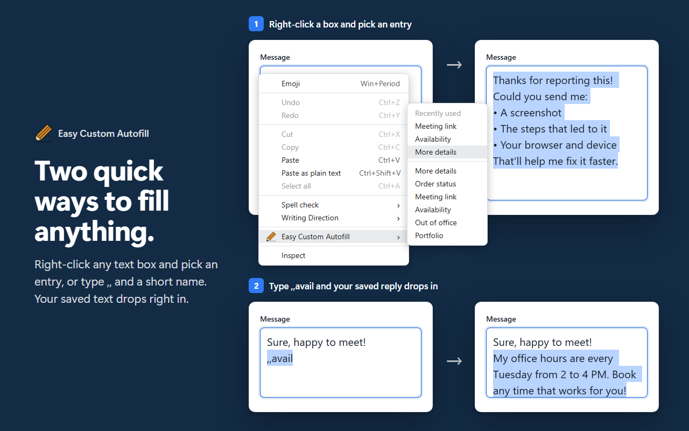
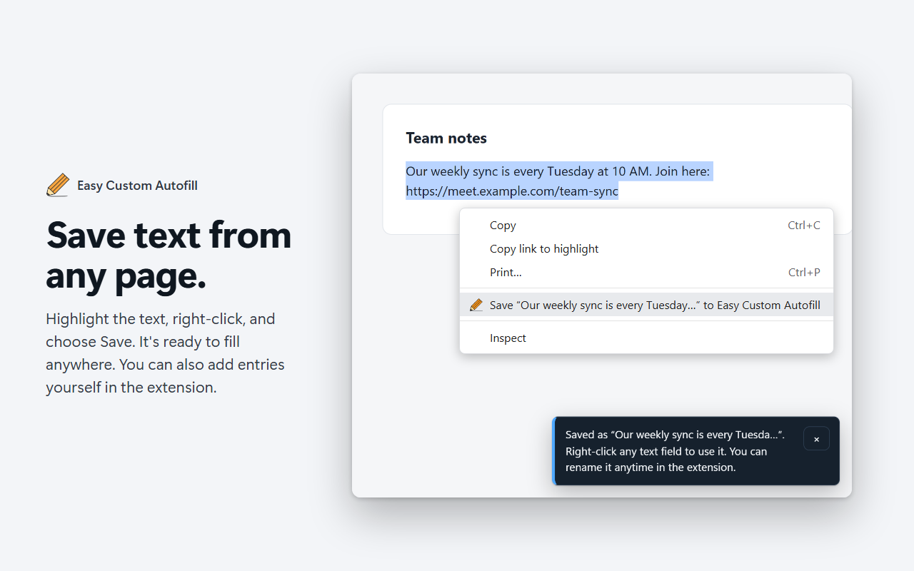
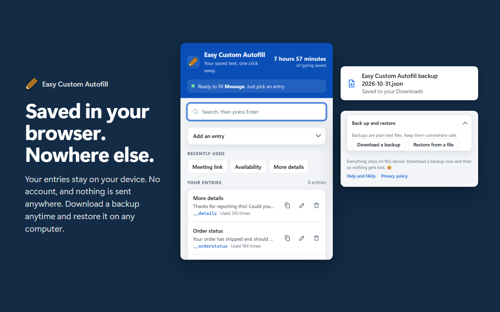
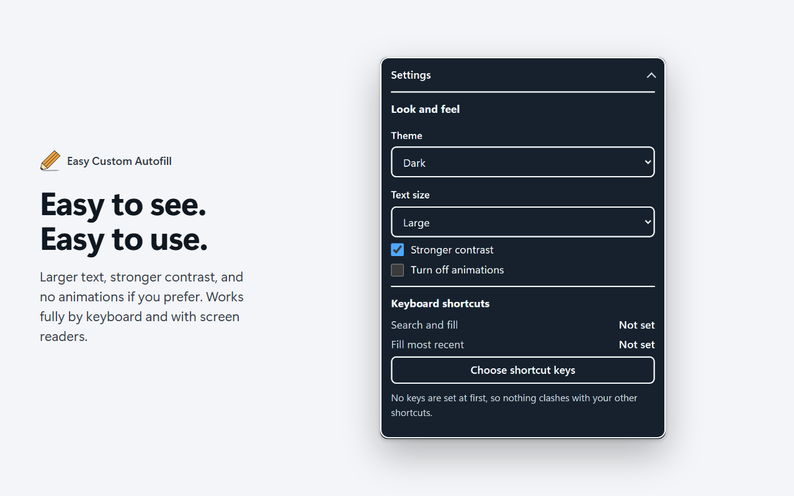
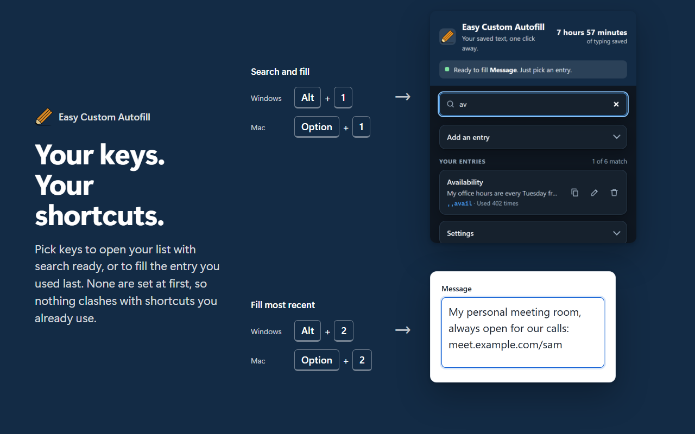

<h1 align="center">Easy Custom Autofill</h1>

Save text you type often, then fill it into any text box with a right-click or a few keys. Everything stays in your browser.

<a href="https://chromewebstore.google.com/detail/easy-custom-autofill/ilhgjljloaeeiognllkcpcfhiegoacfm"><b>Add to Chrome</b></a> · <a href="https://jcari-dev.github.io/Easy-Custom-Autofill/">Website</a> · <a href="https://jcari-dev.github.io/Easy-Custom-Autofill/updated/">Privacy policy</a>

## Ways to fill

- **Right-click** any text box and pick an entry. The ones you used last are at the top.
- **Type to fill:** type `,,` and a short name, like `,,avail`, and the whole text appears. It's optional, and your browser asks you first.
- **Click the extension's icon** and pick an entry, or search and press Enter.
- **Keyboard shortcuts:** open your list with search ready, or fill the entry you used last. None are set at first, so nothing clashes.

## Ways to save

- Highlight text on any page, right-click, and choose **Save**.
- Add and edit entries in the extension, and drag them into any order.

## Private by design

- No account, no tracking, nothing sent anywhere.
- Nothing runs on the pages you visit until you use it.
- Download a backup anytime and restore it on any computer.
- Password fields are never filled.

## Easy to see, easy to use

Light and dark themes, larger text, stronger contrast, and no animations if you prefer. Works fully by keyboard and with screen readers.

## What's new in 3.0

- Fills that stick: sites accept the text as if you typed it.
- Right-click filling works on any page without changing site access, and the menu no longer loses entries.
- Works in pop-up windows and in forms embedded from other sites.
- Safer restore: it opens in its own tab, shows what will change, and never clears your list unless you choose to.
- Type to fill, highlight to save, search, recently used, and a running total of the typing time you've saved.
- Upgrading from 2.x keeps your entries exactly as they are.

## Help

- Open **Help and FAQs** from the extension.
- Found a problem or have an idea? [Open an issue](https://github.com/jcari-dev/Easy-Custom-Autofill/issues).
